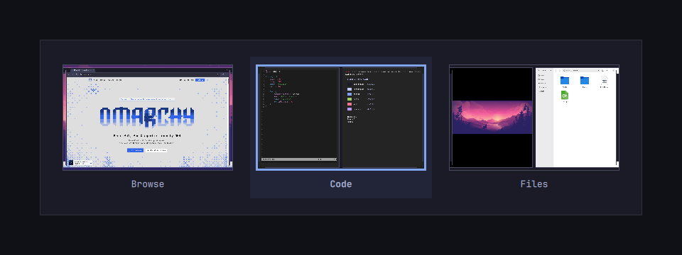

# Omarchy Super Switcher

A macOS-style app, window, and workspace switcher for Omarchy.

https://github.com/user-attachments/assets/e7e3ffde-b8e6-4135-ad40-71d9cadf977b

## Installation

Requires Omarchy with the Quickshell-based Omarchy shell and Hyprland 0.56 or
later with its Lua configuration API. The plugin uses `omarchy-shell`, `hyprctl`,
and the `timeout` command from GNU coreutils.

### Option 1: Quick install (Interactive border choice)

Run the installer directly from your terminal:

```bash
bash <(curl -sSL https://raw.githubusercontent.com/harryxu/omarchy-super-switcher/master/install.sh)
```

### Option 2: Clone and run installer

Clone the repository and run `./install.sh`, which prompts you to choose between
rounded (default) or squared borders:

```bash
git clone https://github.com/harryxu/omarchy-super-switcher.git
cd omarchy-super-switcher
./install.sh
```

You can also specify `--rounded` or `--squared` directly:

```bash
./install.sh --rounded
```

### Option 3: Install via Omarchy CLI

```bash
omarchy plugin add https://github.com/harryxu/omarchy-super-switcher.git --enable
```

Enabling the plugin automatically takes over `Super + Tab`, `` Super + ` ``,
`Alt + Tab`, and their Shift variants for the current Hyprland session.
Installation requires no additional setup or edits to your Hyprland configuration files.

## Keyboard and mouse

| Shortcut | Action |
| --- | --- |
| `Super + Tab` | Next app |
| `Super + Shift + Tab` | Previous app |
| `` Super + ` `` | Next window of the focused app |
| `` Super + Shift + ` `` | Previous window of the focused app |
| Hold `A` with `Super + Tab` or `Super + Shift + Tab` | Show only apps with windows on the current workspace |
| `Alt/Option + Tab` | Next workspace |
| `Alt/Option + Shift + Tab` | Previous workspace |
| `Left`/`Right` or hover | Move the selection |
| `Enter` or click | Activate the selection |
| `Escape` | Cancel |
| `Q` in the app switcher | Ask the selected app to close all its windows across workspaces |

Keep Super or Alt/Option held after pressing the shortcut to browse. Release the
modifier to activate your selection. A quick tap switches without opening the panel.

Hold the full shortcut to advance automatically to the last entry. Holding the
Shift variant moves back to the first entry. Releasing Tab or the grave key stops
automatic movement so you can continue browsing with the modifier held.

You can also hold `A` after the app switcher opens. Keep it held to switch to a
window on the current workspace. Release `A` to see all apps again.

If `Q` brings up a save dialog, the switcher closes and focuses it.

## Screenshots

### Application switcher

| Rounded borders (Default) | Squared borders |
| :---: | :---: |
|  |  |

### Workspace switcher

| Rounded borders (Default) | Squared borders |
| :---: | :---: |
|  |  |

## Applications

The switcher lists each running app once, most recently used first. Switching
to an app focuses its most recently used window.

## Windows

The window switcher cycles through the focused app's windows across workspaces.
Keep holding Super to see still previews with the selected window's title below
its thumbnail. The panel only opens when the app has at least two windows.

## Workspaces

The switcher shows regular workspaces across all monitors, including empty
ones. It lists numbered workspaces in order, then named workspaces alphabetically.

## Border style settings

The switcher uses classic rounded borders by default, and supports squared borders:

| Rounded borders (Default) | Squared borders |
| :---: | :---: |
|  |  |

You can choose between rounded and squared borders during installation, open the
interactive terminal picker, or toggle them via CLI at any time:

```bash
# Open interactive terminal picker (gum choose)
omarchy-super-switcher-setup

# Or change via CLI directly
omarchy-shell harryxu.super-switcher borderStyle
omarchy-shell harryxu.super-switcher setBorderStyle squared
omarchy-shell harryxu.super-switcher setBorderStyle rounded
```

Changes apply immediately to your switcher.

## Workspace preview settings

Previews show still images by default. Live previews update as you browse.
Changes apply the next time you open the workspace switcher.

```bash
omarchy-shell harryxu.super-switcher workspacePreviewMode
omarchy-shell harryxu.super-switcher setWorkspacePreviewMode live
omarchy-shell harryxu.super-switcher setWorkspacePreviewMode static
```

## Removal

```bash
omarchy plugin remove harryxu.super-switcher --yes
hyprctl reload
```

Reloading Hyprland restores the bindings from your configuration.

## License

[MIT](LICENSE)
